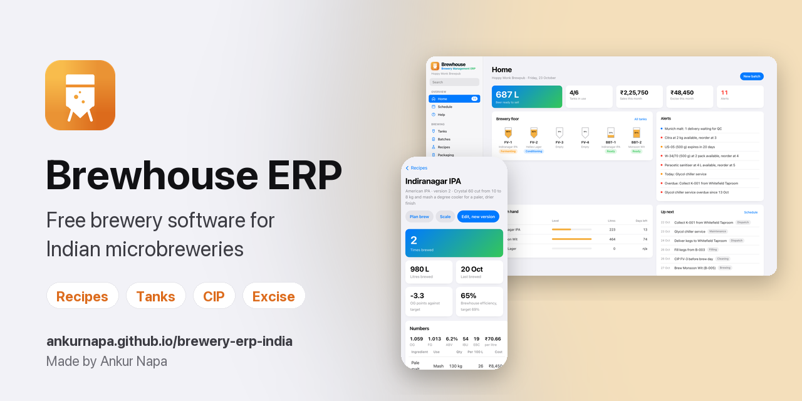

# Brewhouse ERP

A free, browser-based ERP for Indian microbreweries and brewpubs. Grain to glass in one place: recipes, stores, brewing, packaging, kegs, dispatch, taproom sales and the excise register.

**Live app:** https://ankurnapa.github.io/brewery-erp-india/

It opens with a demo brewpub loaded. Tap **Start my brewery** in the bar on Home (or **Settings > Start empty**) when you are ready to enter your own data. It clears the demo, blanks its tax rates and kit, then opens Brewery setup.

## Modules

**Setup.** Masters for customers, vendors, tanks, kegs, machines, raw materials and recipes. Equipment register with a QR tag for every keg, tank and machine. Scanning a tag with a phone camera opens that item in the app.

**Home.** Alerts for low stock, near expiry, pending QC, overdue tasks, service due, kegs left at customers and beers running low. A live picture of the brewery floor with every tank's fill level.

**Controls.** Posted documents are never deleted. Invoices are cancelled by a credit note and dispatches by a reversal, both dated the day they are made, so a month already filed does not change. Losses, CIP records and write-offs are voided with a reason and stay on file. Settings can lock the books up to a date. An activity log records who cancelled, voided, deleted, posted or locked what. Stock is drawn lot by lot: rejected lots are never used and nothing goes negative. A batch needs a passing QC release before it is Ready. Ready is final for excise. These controls guard against mistakes. In a browser-only app they cannot stop someone who edits the browser's storage.

**Receivables and purchasing.** Trade and credit invoices carry the customer's payment terms; payments are recorded against them and Customers shows ageing. Purchase orders take part deliveries and check the vendor invoice. Rejected lots can go back to the vendor. Each lot shows the batches that used it, for a supplier recall. Stock is valued at lot cost with a moving average price. Packaging runs use cans, ends and gas from stores. Cost of goods uses what each batch really cost.

**Period filter.** Home, Reports, Taproom sales, Dispatch, Kegs and Beer losses share one filter: Today, This week, This month, This quarter, This FY or All time. Weeks start on Monday. Quarters and the year follow the Indian financial year from 1 April. The period you pick holds as you move between those screens. Stock, tanks and alerts always show today.

**Schedule.** Month calendar of brewing, filling, dispatch, cleaning and maintenance tasks. A brew planner works out when to brew each beer from its sales rate, stock in hand, beer already in tanks and its average grain to glass cycle.

**Stores.** On hand, reserved for planned batches and available stock. Reorder levels, expiry dates and QC approval on receipt. Material wastage. MRP suggests orders and raises purchase orders per vendor. Receiving a PO adds the stock and holds it for QC.

**Recipes.** A mass balance engine. Extract kg is carried from the grain bill through mash, kettle, boil, fermenter and bright beer to sellable litres. Plato is solved from extract mass and volume at every step (extract kg = litres x gravity x °Plato / 100). Malt extract is entered as % as is, straight from the malt analysis. It also works out strike and sparge water, brewhouse efficiency, OG, FG, ABV (Hall's formula), IBU (Tinseth, with whirlpool hops at half utilisation and dry hops at none), colour (Morey, in EBC), dry hop absorption and cost per sellable litre, all live as you type. Each ingredient gets a use that fits it. Malt goes in the mash. Hops go in the boil, the whirlpool or the dry hop. Yeast is pitched. Adjuncts go in the mash, boil or fermenter, which covers fruit beer, cider and seltzer. Recipes can be duplicated and scaled. Every edit saves a full new version. Batches remember the version they used.

**Production.** Batches move from Planned to Brewing, Fermenting, Conditioning, Ready and Sold out. Ingredients are issued when a batch leaves Planned. A step by step brew log captures mash temperature, gravities, volume and pitch temperature. Anything outside tolerance is flagged. Fermentation readings (gravity, temperature, pH) draw a curve per tank.

**Transfers.** Move a batch from fermenter to brite tank. Litres left behind and lost in the move are recorded. The old tank is marked dirty with a CIP task.

**CIP.** Every tank carries a hygiene state: Dirty, Cleaned or Sanitised. Log each cycle with strength, temperature, minutes, chemical used and a pass or fail check. Chemicals come off stores. Filling a tank that is not sanitised within the CIP window asks for confirmation. Dirty tanks with a brew planned raise an alert.

**Beer losses.** Losses by stage: fermentation, transfer, packaging, taproom, dispatch, QC samples, dumps and unexplained. Transfer and packaging losses are captured automatically. Each batch record shows its loss balance against a target. The Beer losses screen ranks stages and batches. Excise is booked on litres in tank at Ready, after recorded losses.

**Stock take.** A blind count of raw materials, packaged goods, beer in every tank and kegs. Review shows variance in quantity and value. Each variance needs a reason. Posting writes permanent adjustments. Beer variances become unexplained losses on that batch. A beer reconciliation runs from the last posted count: opening + brewed − sold − packaged − losses against what was counted.

**Packaging.** Kegging, canning and bottling runs, capped at the litres left in the tank. Kegs are picked from empty stock and tagged to the batch.

**Dispatch.** Kegs and packaged beer sent to customers. Kegs are tracked through Filled, At customer, Cleaning, Empty and Lost.

**Kegs.** A page of its own under Sales. Every keg keeps its own history: filled with which batch, sent to whom, back when. A map on OpenStreetMap shows each customer with the kegs they hold, red where one has been out over 30 days. Keg turns show the average days from filling to return, turns a year, the slowest accounts and the value of lost kegs. Bulk scan moves a whole load at once: scan the QR tags with the phone camera (Chrome on Android) or type the codes. Kegs with barcodes etched by the maker keep their own codes. The keg register downloads as CSV. Dispatch lines record the batch they shipped from, so a recall still finds bars that got a batch after the kegs came back and were refilled.

**Batch lifecycle record.** One page per batch: brew day against target, deviations, ingredients issued with cost, fermentation curve, packaging, where every keg is now, dispatches and excise. Printable.

**Taproom sales.** Invoices with VAT on beer and GST on food, printable as tax invoices. Every pour comes off that beer's stock.

**Utilities and wastage.** Electricity, water, fuel and CO2 for COGS. Beer written off.

**Reports.** Business (revenue, COGS per litre, margin), production, consumption, dispatch, stock position, batch quality plus recipe versus batch with brewhouse and volume efficiency.

**Excise and tax.** Excise register booked when a batch is marked Ready, plus a monthly VAT and GST summary.

## Tax treatment

Alcoholic liquor for human consumption sits outside GST in India. Beer is taxed through state excise and state VAT, while food in a brewpub carries GST split as CGST and SGST. Rates differ by state, so set your own in Settings. The demo rates are placeholders.

## Where your data lives

Everything you enter is stored in your browser (localStorage). Brewery records are never sent to a server. Use **Settings > Export backup** often. Import that file to move to another computer.

Anonymous usage analytics (Google Analytics 4) load only if a visitor chooses Allow on the consent prompt. They count screens and a fixed set of actions, never brewery records. See the [Privacy policy](privacy.html) and [Terms of use](terms.html).

This also means each browser has its own copy. A QR scan on a phone shows the phone's data, not the office laptop's. Sharing one live dataset across devices and adding user logins with access levels both need a backend, which this version does not have.

## Design

Clean white cards in the spirit of modern brewery software, laid out to Apple's Human Interface Guidelines: system font and colours, a sidebar on wide screens, a tab bar and bottom sheets on phones, 44 px touch targets and full dark mode.

## Run it locally

Serve the folder with any static server, for example `python3 -m http.server`, then open `http://localhost:8000`. There is no build step. ES modules need a server, so opening `index.html` from disk will not work.

After editing any file in `js` or `css`, run `npm run stamp`. It stamps each file with a content hash so browsers never mix old and new files. `npm test` runs the copy check, the stamp check and 25 Playwright flow tests. GitHub Actions runs the same on every push.

## Credits

The tank view and fermentation readings take their lead from [Brewery Pi](https://github.com/brewerypi/brewerypi) by Deschutes Brewery (MIT licence). The feature scope follows what brewery ERPs such as Worter describe publicly. No code from either is used here. QR codes are drawn with [qrcode-generator](https://github.com/kazuhikoarase/qrcode-generator) (MIT).

## Made by

Brewhouse ERP is made by [Ankur Napa](https://www.linkedin.com/in/ankur-napa). Facing difficulty? Let's schedule a call: [napaankur@gmail.com](mailto:napaankur@gmail.com?subject=Brewhouse%20ERP%3A%20let%27s%20schedule%20a%20call).

## Licence

MIT
